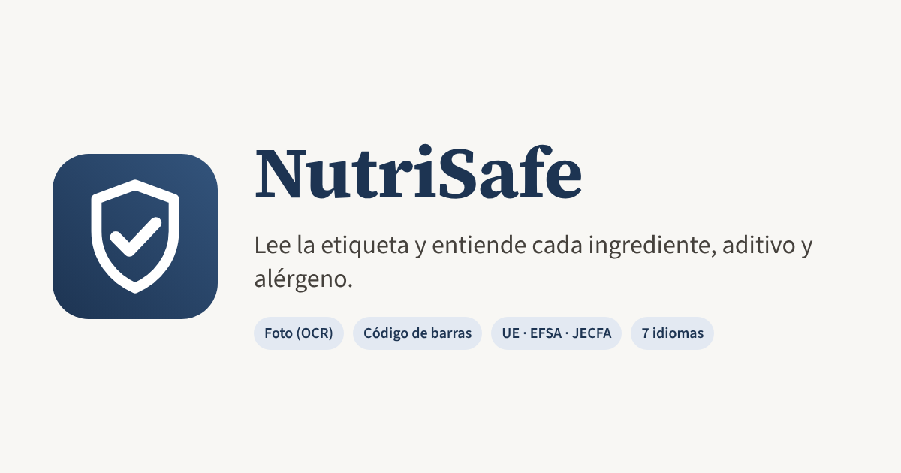

  

  <a href="https://dotstefano.github.io/nutrisafe/"><b>Abrir la app →</b></a>

  
  
  

# NutriSafe

> 🚧 **Proyecto en desarrollo.** La app ya se puede usar, pero sigue creciendo: pueden faltar ingredientes, la lectura de fotos puede fallar con etiquetas difíciles y algunas funciones cambiarán. Toda sugerencia o error que encuentres ayuda a mejorarla.

## Por qué existe

Las etiquetas de los alimentos no siempre hablan claro. El mismo ingrediente puede aparecer como **E-330**, **ácido cítrico** o **citric acid**. Un azúcar puede esconderse detrás de **jarabe de glucosa-fructosa**, **dextrosa** o **maltodextrina**.

Con NutriSafe puedes **buscar los ingredientes de forma manual o fotografiando la etiqueta** y ver **con qué otros nombres aparecen en los envases**, en siete idiomas. Así puedes decidir su consumo de forma consciente e informada.

**Un nombre comercial o técnico no debería ser una barrera para decidir sobre nuestra alimentación.**

## Qué es

**NutriSafe lee la etiqueta de un alimento y explica cada ingrediente, aditivo y alérgeno:** qué es, si está autorizado en la Unión Europea, su ingesta diaria admisible (IDA) y si encaja con tu perfil.

Funciona en el navegador del móvil o del ordenador, sin instalar nada ni crear cuentas.

## Qué hace

| | |
|---|---|
| 📷 **Foto de la etiqueta** | Lee la lista de ingredientes con PaddleOCR (PP-OCRv5), directamente en tu móvil. Reconoce los 7 idiomas sin elegir ninguno, aguanta fotos torcidas o con mala luz, y tiene Tesseract de respaldo. **El texto leído se puede corregir** antes de analizarlo. |
| 🏷️ **Código de barras** | Busca el producto en Open Food Facts: ingredientes, información nutricional, Nutri-Score y NOVA. |
| 🅰️ **Nutri-Score** | Calcula la letra con el algoritmo oficial de 2023 a partir de la tabla nutricional: escribiendo los valores, fotografiando la tabla o desde un producto de Open Food Facts. Muestra el desglose de puntos y qué cambio mejoraría la letra. |
| ✍️ **Pegar o escribir** | Analiza una lista copiada y entiende paréntesis, porcentajes, "puede contener trazas de…", etc. |
| 🔎 **Buscador** | Unos 3 500 ingredientes, aditivos (E-numbers) y nutrientes con sus sinónimos en 7 idiomas: es, en, fr, nl, de, it y pt. |
| ⚠️ **Alérgenos** | Detecta los 14 alérgenos de declaración obligatoria en la UE (Reglamento 1169/2011). |
| 👤 **Perfil** | Avisa de lo que quieres evitar: alérgenos, aditivos, ingredientes de origen animal (vegano o vegetariano)… |
| 📊 **Comparar e historial** | Guarda los productos analizados y compáralos lado a lado. |
| 🌍 **7 idiomas** | La app se muestra en el idioma del dispositivo (español, inglés, francés, neerlandés, alemán, italiano o portugués) y se puede cambiar en la cabecera. Las fichas, incluidos los nombres de los ingredientes, también se traducen. |

## Fuentes de datos

- **Comisión Europea:** lista de aditivos autorizados (Anexo II del Reglamento (CE) 1333/2008) y formas autorizadas de vitaminas, minerales y otras sustancias (Reglamento (CE) 1925/2006, Directiva 2002/46/CE y Reglamento (UE) 609/2013).
- **EFSA:** OpenFoodTox, con las IDA y otros valores de referencia.
- **OMS/FAO:** evaluaciones del JECFA.
- **OCR:** [PaddleOCR](https://github.com/PaddlePaddle/PaddleOCR) (modelos PP-OCRv5, licencia Apache-2.0) sobre [ONNX Runtime Web](https://onnxruntime.ai/) (MIT), con [Tesseract.js](https://tesseract.projectnaptha.com/) (Apache-2.0) como respaldo.
- **Open Food Facts:** taxonomías de ingredientes, aditivos y alérgenos, y la base de productos. Licencia [ODbL](https://opendatacommons.org/licenses/odbl/).

## Privacidad

Las fotos se procesan en tu propio dispositivo y no se suben a ningún servidor. La primera vez la app descarga los modelos de lectura (unos 24 MB) y después los guarda en el navegador. El perfil y el historial se guardan solo en tu navegador. La única consulta externa es el código de barras, que se envía a Open Food Facts.

## Aviso

NutriSafe es una herramienta informativa y no sustituye el consejo médico ni nutricional. Ante una alergia o una intolerancia, confía siempre en la etiqueta original del producto.

---

Hecho por **Stefano Simonetti Macaya**.
